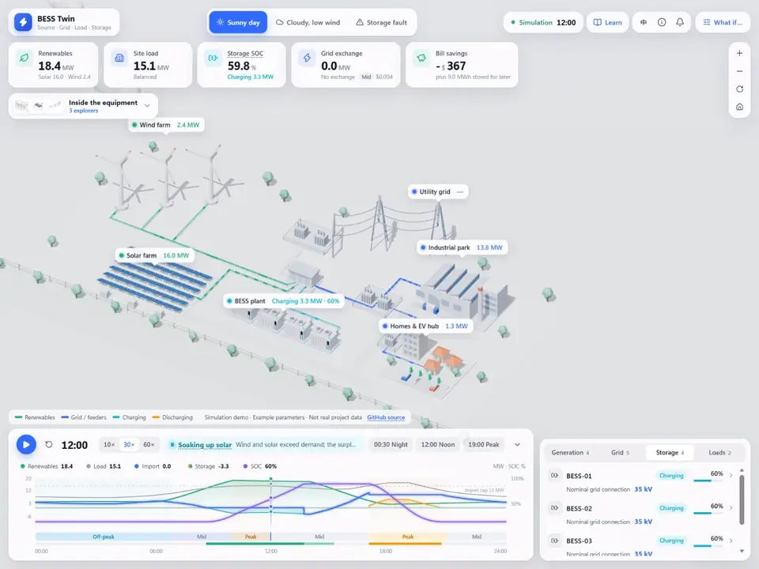
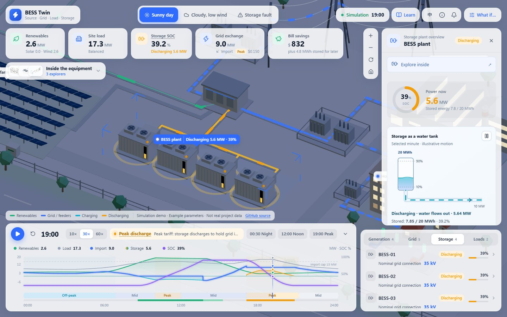
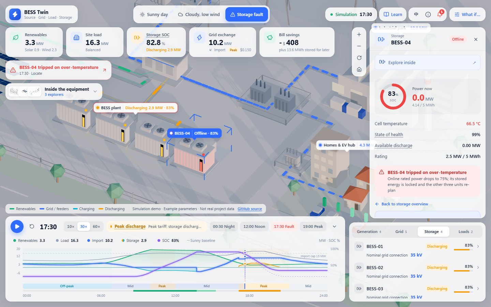
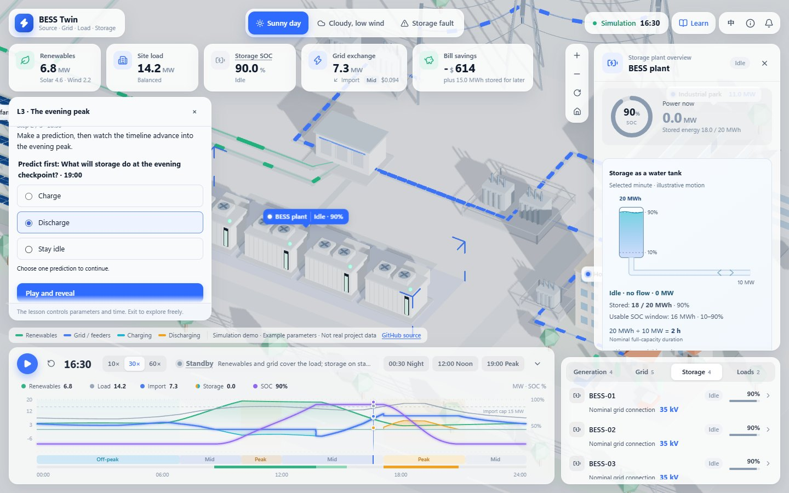
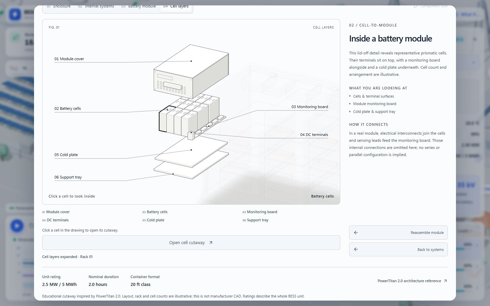
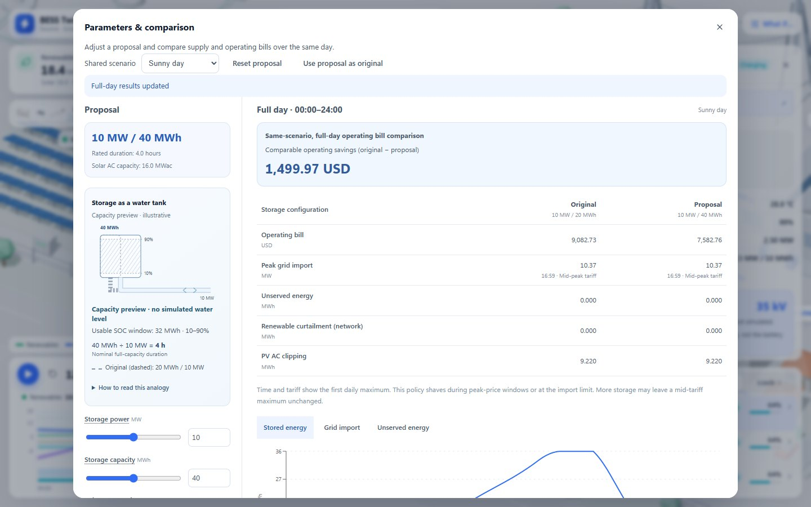
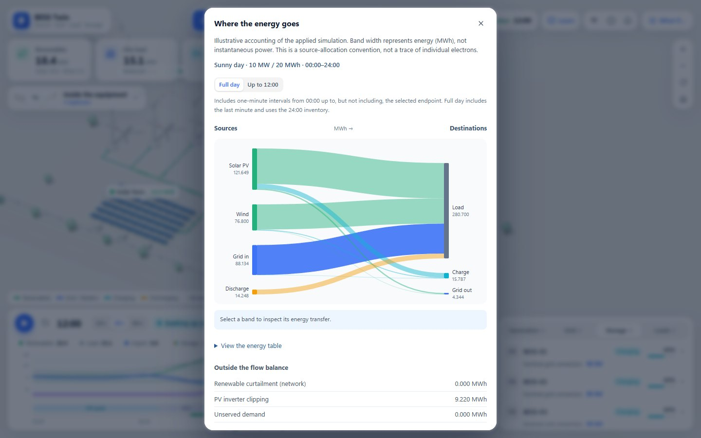

# BESS Twin

An interactive digital twin of a renewable energy park — solar, wind, battery storage, the grid and consumers — built to show beginners how a battery energy storage system (BESS) actually operates through a day.

**[Live demo](https://bokaihe.github.io/BESS-Twin/)** · **[Source](https://github.com/BokaiHe/BESS-Twin)** · **[Detailed guide](docs/guide.md)**



## What you can do

- **Watch a full day play out** in a 3D park: solar soaks up the morning, storage discharges through the evening peak, and power flows animate along every line.
- **Learn by predicting:** five short lessons pause at key moments and ask what the battery will do next, then reveal the answer with the simulation's own numbers.
- **Try design challenges:** keep a cloudy day supplied, stay under an import cap, or absorb surplus renewables with the smallest battery.
- **Look inside the equipment:** take apart a storage container down to a single cell, a solar module down to its silicon layers, and a wind turbine down to its drivetrain.
- **Ask “what if”:** change storage size, renewables, grid limits or tariffs and compare the new design with the original over the same day.
- **Switch between English and Chinese** at any time; everything works on desktop and mobile.

## Screenshots

| Evening peak                                                                         | Storage fault                                                                         |
| ------------------------------------------------------------------------------------ | ------------------------------------------------------------------------------------- |
|  |                |
| **Predict, then reveal**                                                             | **Inside a battery module**                                                           |
|    |   |
| **What if the battery were twice as large?**                                         | **Where the day's energy went**                                                       |
|      |  |

## How it works

Validated parameters and a day scenario go to a Web Worker, which simulates all 1,440 minutes once. The scene, cards, charts, lessons and explorers then read the same immutable snapshots, so scrubbing the timeline never recalculates anything.

A few modelling choices keep the results honest:

- **Periodic days:** sunny and cloudy days end with the stored energy they started with, so savings never come from draining the battery.
- **No savings from shortages:** a design that serves less demand is not reported as cheaper; unserved energy, curtailment and inverter clipping are tracked separately.
- **Peak shaving first:** storage protects the grid import limit before it chases tariff spreads, and re-plans when a unit trips.
- **Read-only learning layer:** lessons and challenges never change the physics; their answers and thresholds are verified against the engine in tests.

The reference park has 20 MWp of solar, 3 × 4 MW wind turbines, 4 × 2.5 MW / 5 MWh of storage and a 15 MW grid connection. Full dispatch rules and conventions are in the [simulation specification](docs/simulation.md).

## Run locally

Requires Node.js 22.12 or newer and a WebGL-capable browser. No backend, API keys or paid services.

```bash
git clone https://github.com/BokaiHe/BESS-Twin.git
cd BESS-Twin
npm ci
npm run dev
```

Then open the URL printed by Vite (normally `http://127.0.0.1:5173/`). On Windows PowerShell, use `npm.cmd` if script execution is blocked.

| Command                      | Purpose                                        |
| ---------------------------- | ---------------------------------------------- |
| `npm test`                   | Simulation, accounting and data-contract tests |
| `npm run test:e2e`           | Playwright browser tests                       |
| `npm run build`              | Type-check and production build                |
| `npm run demo:record`        | Re-record the demo video and README preview    |
| `npm run readme:screenshots` | Re-capture the README screenshots              |

All commands, the project structure and deployment notes are in the [detailed guide](docs/guide.md#development-commands).

## Tech stack

React · TypeScript · Vite · Three.js (React Three Fiber) · Recharts · Web Workers · Playwright · Vitest · GitHub Actions / Pages

123 unit tests and 99 browser tests cover power balance, SOC and grid limits, deterministic seeking, bill comparability, lessons, challenges, explorers and mobile layouts. See the [verification log](docs/verification.md).

## Limitations

This is an illustrative, active-power simulation with example parameters — not a connection to real equipment, a power-flow study or an investment tool. Reactive power, detailed network losses and battery ageing are not modelled; temperatures and SOH are illustrative. The equipment cutaways are teaching models, not manufacturer drawings.

## Documentation

- [Detailed guide](docs/guide.md) — every feature, the reference system, explorers, learning edition and developer notes
- [Simulation specification](docs/simulation.md) and [data contract](docs/data-contract.md)
- [Learning edition specification](docs/learning-edition-spec.md)
- [Verification log](docs/verification.md)
