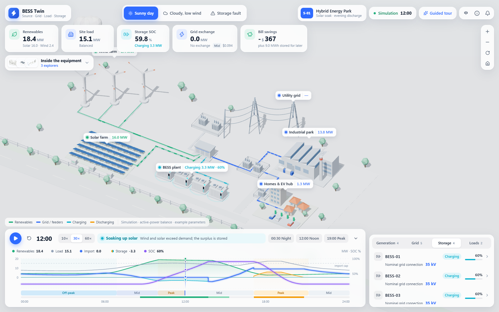

# BESS Twin

An interactive digital twin of a renewable energy park, built with React, Vite, TypeScript and Three.js. Explore how solar, wind, battery storage, the utility grid and consumers work together throughout a simulated day.

**[Live demo](https://bokaihe.github.io/BESS-Twin/)** · **[Source](https://github.com/BokaiHe/BESS-Twin)**



> This is an illustrative simulation, not a connection to operating equipment or a remote-control system.

## Features

- **Interactive 3D site:** procedural solar panels, wind turbines, battery containers, substations, industrial buildings and homes, with animated power flows and camera controls.
- **Three full-day scenarios:** sunny, cloudy with low wind, and a battery over-temperature fault.
- **Deterministic playback:** 1,440 immutable minute snapshots per scenario. Seeking reads a snapshot; it never integrates energy or costs again.
- **Shared electrical topology:** cards, connected-line highlights, particle directions and charts read the same node and edge data.
- **Equipment-specific details:** power, SOC, temperature, available discharge capability, nominal AC voltage levels, ratings and alarms. Voltage labels describe the topology, not measured operating voltage.
- **Equipment explorers:** an expandable preview hub opens interactive BESS, solar and wind cutaways, with progressive disassembly, component descriptions and bilingual explanations.
- **Teaching animations:** battery charge/discharge transport, solar photon absorption and charge separation, and wind-driven rotor and drivetrain motion inside the cutaway views.
- **Tariff-aware operation:** peak shaving takes priority; renewable surplus is stored before grid charging is considered.
- **Transparent bill comparison:** full-day and up-to-now breakdowns, with explicit treatment of baseline supply shortages and fault-day energy inventory.
- **13-step guided walkthrough:** module explanations, highlights, camera focus, Back/Next and early exit. Playback pauses during the tour.
- **Public sharing:** static Open Graph / large-image card metadata, a screenshot preview, a one-time optional tour hint, and a visible simulation disclosure with a source link.
- **English by default**, with a Chinese language toggle and persistence of explicit language choices.
- **Responsive layout** for desktop and mobile.

## Parameter challenges (local learning edition)

Open **Learn → Parameter challenges** to try four engine-backed tasks: keep a cloudy day supplied, stay under an 8 MW import cap, explore tariff spreads, and absorb excess renewables. Only the relevant controls are editable; the original design stays fixed to each challenge's starting configuration. Goals and stars update only after the latest full-day result arrives. Best passing scores are saved locally, shared across languages, with a session-only fallback when browser storage is unavailable.

Exiting restores both free-mode designs, scenario, time, selection, camera and playback settings. C1/C2 reward improved supply even when the starting design has shortages. C3 uses the proposed tariff's **own no-storage baseline**, never a bill difference across tariffs; valley and mid prices cannot exceed their starting levels. C4 counts network curtailment separately from inverter clipping. These are instructional targets for the existing dispatch policy, not an optimization or investment recommendation.

Reproduce the candidate scan with `node scripts/scan-challenges.mjs`. It verifies a failing start and reachable one-, two- and three-star designs for every challenge; results are in [docs/challenge-scan.json](docs/challenge-scan.json). The finite scan does not claim globally optimal sizing. This learning edition has not been pushed or deployed.

## Run locally

Use Node.js 22.12 or newer. Node.js 24 is used for deployment and has been verified locally.

```bash
git clone https://github.com/BokaiHe/BESS-Twin.git
cd BESS-Twin
npm ci
npm run dev
```

Open the local URL printed by Vite, normally `http://127.0.0.1:5173/`.

On Windows PowerShell, use `npm.cmd` if execution policy blocks `npm.ps1`.

No backend, API keys, external 3D assets or paid services are required to run the demo. A WebGL-capable browser is recommended for the 3D view.

## Explore the demo

1. Open **Learn → Guided tour** for a step-by-step introduction to the modules.
2. Select a full-day scenario at the top of the screen.
3. Use the timeline, chart or time bookmarks to inspect midday and the evening peak.
4. Select a 3D object, label or device row to inspect its measurements and connected lines.
5. Open **Inside the equipment**, or **Explore inside** in a matching device card, to inspect the BESS container, solar module or turbine.
6. Open the bill card to compare costs, or the alarm bell to locate affected equipment.

The fault scenario jumps to 17:30, when BESS-04 trips. Dashed grid and SOC curves show the sunny-day reference. Power curves use minute-by-minute steps so the fault impact is not drawn before it occurs.

## Reference system

| Component                     | Configuration                                                       |
| ----------------------------- | ------------------------------------------------------------------- |
| Solar PV                      | 20 MWp DC / 16 MW AC                                                |
| Wind                          | 3 × 4 MW                                                            |
| BESS                          | 4 × 2.5 MW / 5 MWh; 10 MW / 20 MWh total                            |
| Battery operating range       | 10–90% SOC                                                          |
| Charge / discharge efficiency | 95% / 95%                                                           |
| Grid exchange                 | Import and export each limited to 15 MW                             |
| Grid connection               | External 110 kV grid → 110/35 kV transformer → 35 kV collection bus |
| Consumers                     | Industrial load and residential / EV load with staggered peaks      |

Generation, storage and loads connect in parallel through the collection bus. Storage is bidirectional; it is not a mandatory series link between generation and consumers.

### Dispatch and fault behavior

The model prioritizes the grid limit, stores renewable surplus, and plans tariff-based charging and discharge while retaining energy for peak shaving. It assumes perfect weather and load forecasts; equipment faults are not anticipated.

Sunny and cloudy days use periodic initial conditions: day-end stored energy equals day-start stored energy, at approximately 15% initial SOC. The fault day starts from the sunny state but is **not periodic**. At 17:30, BESS-04 goes offline and its energy is frozen; the remaining units provide up to 7.5 MW of rated power, subject to SOC constraints.

### Time and financial semantics

Each snapshot describes a one-minute interval. Power applies to that interval; SOC and accumulated costs describe its start. Full-day totals include the final interval and live in `day.summary`.

Bill difference is the no-storage baseline's net energy bill minus the storage case's bill, with identical weather, demand, tariffs and grid limits. If the baseline leaves demand unserved, a like-for-like savings claim is unavailable: the UI labels the raw bill difference, hides the savings percentage, and the report sets `daySavingsCny` to `null`.

Fault-day inventory changes and frozen offline energy are reported separately. Bills do not assign a monetary value to inventory changes. Example tariffs exclude demand charges, depreciation, maintenance and investment costs. English currency values use a disclosed illustrative CNY-to-USD conversion.

The fixed simulation date is `2026-06-18`, UTC+08:00; it is independent of the computer's current date.

## Development commands

| Command                      | Purpose                                               |
| ---------------------------- | ----------------------------------------------------- |
| `npm run dev`                | Start the local Vite server                           |
| `npm test`                   | Run the simulation and data-contract tests            |
| `npm run build`              | Type-check and build for a site served at `/`         |
| `npm run build:pages`        | Build for the GitHub Pages `/BESS-Twin/` path         |
| `npm run preview`            | Preview a local production build                      |
| `npm run test:e2e`           | Run Playwright desktop, mobile and walkthrough checks |
| `npm run report`             | Regenerate `docs/simulation-report.json`              |
| `npm run format:check`       | Check formatting                                      |
| `npm run cabinet:build`      | Regenerate and audit the container geometry           |
| `npm run cell:build`         | Regenerate and audit the battery cell geometry        |
| `npm run cell:orbit-audit`   | Check the cell cutaway camera and projection          |
| `npm run renewables:build`   | Regenerate and audit solar and wind geometry          |
| `npm run explorers:previews` | Refresh the three explorer preview images             |

The browser tests currently use the installed Microsoft Edge channel and start a test server on port 5178. On a machine without Edge, install that browser or change `channel` in `playwright.config.ts` to a browser available in your environment.

The test suites contain **97 unit tests** and **74 browser flows**. Coverage includes scenario changes, deterministic seeking, the exact fault boundary, bill comparability, language persistence, all 13 walkthrough steps, equipment disassembly, battery transport, solar/wind generation animations and the explorer hub. See [verification notes](docs/verification.md) for results and known limitations.

## Project structure

```text
src/
  domain/       Types, capacities and electrical topology
  simulation/   Deterministic profiles, dispatch, energy and bill calculations
  data/         Snapshot data-source adapter
  components/   Three.js scene, SVG cutaways, geometry and teaching animations
  ui/           Dashboard cards, explorer hub, dialogs and guided walkthrough
  i18n.tsx      Dashboard copy and English explorer copy
  explorerCopyZh.ts  Chinese explorer copy
  App.tsx       Application state and coordination
e2e/            Browser regression tests
public/explorers/  Generated preview images used by the explorer hub
scripts/        Simulation reports, geometry generators and preview capture
  anatomy-kit/  Vendored geometry utilities with their MIT license
docs/           Model specifications, data contract, verification and screenshots
.github/        Automated GitHub Pages deployment
```

Simulation code has no React or render-loop dependencies. The interface reads `Snapshot` objects through `TwinDataSource`; a future live adapter will need validation, device mapping, timestamp alignment and explicit handling of stale or missing measurements.

Additional engineering documents are currently in Chinese: [simulation specification](docs/simulation.md), [data contract](docs/data-contract.md), and [verification record](docs/verification.md).

## Deployment

The GitHub Actions workflow runs unit tests, builds with `npm run build:pages`, and deploys `dist/` to GitHub Pages on pushes to `main`. It can also be triggered manually. The deployment uses GitHub's built-in token; no repository secret or third-party hosting account is required.

For a fork, enable **Settings → Pages → GitHub Actions**. If the repository name changes, update the Pages base path in `vite.config.ts` and the demo link above.

Local build products, dependencies, test traces, logs, environment files and editor-specific settings are ignored by Git.

## Model boundaries

This is an active-power balance demonstration, not an AC power-flow or protection study. Reactive power, detailed network losses, battery ageing and physical thermal dynamics are not modeled; temperature and SOH are illustrative. Real telemetry and remote equipment control are not implemented.

The 3D and chart bundles are comparatively large. The main scene is loaded with the entry page to avoid a cold-start dependency waterfall; equipment explorers remain lazy-loaded. Rendering quality and speed depend on the browser and GPU.

Nominal AC voltage is displayed in device lists and detail cards. Storage's 35 kV value describes its collection-bus connection after step-up, not the battery DC or PCS terminal voltage. Operating voltage is not simulated.

### Known interface issues in this snapshot

- Chinese solar explanations currently use the same term for solar cells and battery cells; terminology should be differentiated in a follow-up.

This terminology issue remains in the current version.

## Equipment explorers

The hub reserves space above the timeline on desktop. Viewports at most 900 px wide or 740 px high use a vertically scrolling page, so previews, close controls and fault alerts remain reachable. Expanding the hub focuses its first card; collapsing restores focus to the badge; closing an explorer returns focus to its originating card.

The **Inside the equipment** badge below the KPI cards expands into preview cards for the three explorers (BESS container, solar module, wind turbine); each card opens its explorer directly. The same explorers remain available from **Explore inside** in the matching detail card. All explorer copy follows the language toggle: English lives in `src/i18n.tsx`, Chinese in `src/explorerCopyZh.ts`, and TypeScript checks that both have the same shape. Explorer type and colours are aligned with the main interface. Preview images in `public/explorers/` are captured from the real explorers with `npm run explorers:previews` (re-run after geometry changes).

### BESS Container Explorer

Select the BESS cluster or a BESS unit and choose **Explore inside**. The Anatomy
SVG explorer offers enclosure, internal-system, extracted-module and cell-layer views with
clickable components, explanations in English or Chinese, light/dark drawing themes, an optional
component tour, keyboard controls and reduced-motion support. Each opening starts on **01 Enclosure** with the component tour off; click the enclosure or **Remove enclosure** to continue.

Click a battery rack (or its numbered button) to slide out its top example module. Choose **Reveal cell layers** or click the extracted module to lift the cover, reveal the cells and monitoring board, and separate the cold plate. **Reassemble module** and **Back to systems** reverse the sequence, including when interrupted. Camera movement and depth sorting share one animation coordinate; reduced motion jumps to the requested pose.

The app opens on the site overview. Select a BESS object, label or device row, then choose **Explore inside** at the top of its detail card. Closing the explorer returns to the same selection. Legacy `?view=container` links also open the overview instead of automatically showing a dialog. This is a
healthy-system educational cutaway inspired by the PowerTitan 2.0 architecture,
not manufacturer CAD or a maintenance procedure. It does not add equipment
control or simulated cell-level telemetry. Existing simulation ratings are unchanged.

The expanded view includes callouts for the module cover, cells, monitoring board, DC terminals, cold plate and support tray. One representative cell is highlighted. Click a physical cell or use **Open cell cutaway** to open its animated interior. Select **Cathode (+)**, **Anode (−)**, **Separator** or **Electrolyte** for role descriptions. Electrolyte is shown as wetting inside the porous layers, not a fourth solid sheet. **Reassemble cell** reverses the animation; **Back to module** retains the selected cell. The four material controls also support keyboard and narrow-screen use.

After the cell unfolds, the camera turns to a level front view and the housing fades out before transport starts. The return animation reverses this sequence. Slate-blue ions and graphite electrons match the drawing palette. Drag with the mouse to orbit the expanded cell; scroll over it to zoom at the pointer. **Reset view** restores the front camera and default zoom. Arrow keys rotate; **+ / −** zoom and **Home** resets. The view is bounded to keep the layers inspectable (yaw ±55°, pitch −25° to +40°, zoom 65–220%). Touch scrolling is preserved; camera buttons remain available on narrow screens. Material clicks are separate from dragging, and paused transport stays attached to the electrodes as the camera changes.

In the cell interior, **Discharge / Charge** reverses lithium-ion travel through the electrolyte and separator and electron travel through the external load or DC source. Symbols, arrows and descriptions distinguish the two routes. **Pause flow / Play flow** controls the illustration. Reduced motion keeps static direction arrows; transport hides while the cell is reassembled. This repeating teaching animation is independent of plant dispatch, SOC and real particle speeds.

Geometry source and checks: `npm run cabinet:build` and `npm run cell:build`, plus `npm run cell:orbit-audit` (Anatomy support/depth and motion audits).
UI checks: `npx playwright test e2e/container.spec.ts`.
See [the design brief](docs/cabinet-cutaway.md) for scope, provenance and reference.

## Solar and wind equipment explorers

Select **Solar farm** or a **Turbine WT-0x** in the plant scene or the **Generation** device list, then choose **Explore inside**. Every opening starts on the complete equipment. The wind overview immediately shows airflow and a rotating rotor; it stays on the first level until you choose to open the nacelle.

- **Solar module:** separate the glass, encapsulant, cell circuit, backsheet and frame; click a cell to reveal a representative silicon cell's rear contact, base, emitter/junction, optical coating and front contact grid.
- **Wind turbine:** open the nacelle, zoom into its interior and separate the main shaft/bearings, gearbox, high-speed shaft/brake and generator. Select the cooling equipment, yaw support, housing, rotor or wind sensor for their roles.

Physical parts and named buttons select an explanation and highlight the corresponding assembly. Viewing-level buttons, **Previous level** and **Reassemble** provide reversible transitions. Both explorers support keyboard controls, light/dark themes, reduced motion and narrow screens. Static SVG geometry is generated at build time; animation updates transforms and camera framing through refs. The background plant pauses while an equipment explorer is open.

These are healthy-system teaching models, not manufacturer CAD. The PV figure uses a representative crystalline-silicon glass/backsheet architecture; the turbine uses a geared architecture. Illustrated counts and proportions are not equipment ratings. Existing dispatch and simulation data remain unchanged.

Geometry generation and audit: `npm run renewables:build`.
Browser checks: `npx playwright test e2e/renewables.spec.ts`.
See [the design brief and technical references](docs/renewable-explorers.md).

### Generation animations inside the cutaways

Expand to **Cell detail** (solar) or **Drivetrain** (wind). **Play animation** appears below the same drawing when the expansion finishes. There is no separate generation mode. The existing layer/component buttons, physical hit targets, highlight and role descriptions remain available during playback.

- **Solar:** stronger warm sunlight beams illuminate the cell; a local absorption glow precedes electron–hole separation. External electron flow and charge paths align with the exploded silicon layers and contacts. An external DC load completes the teaching circuit.
- **Wind:** incoming air streaks approach the rotor while shortened blades and the low-speed shaft turn together; high-speed shaft and generator rotor turn at an illustrative 4:1 ratio. Bearings, stator, housing and supports remain fixed. All overlays use the original parts' projected coordinates and exploded offsets.

The solar cell and exploded drivetrain start paused. The complete wind turbine starts playing on entry, without advancing the viewing level. **Play / Pause** and **Sunlight / Wind** affect the illustration only. Returning to another layer or reassembling stops playback; expanding the drivetrain again waits for an explicit play action; returning to the complete turbine resumes its overview animation. Reduced motion shows static directions. Offscreen and hidden-tab animation clocks stop automatically.

Exploded gaps are for inspection: charge routes and synchronized rotation explain an intact system, not real charge transport through air or torque transmission across disconnected shafts. Sizes, speeds and the ratio are educational. Plant dispatch and telemetry remain unchanged.

Geometry checks: `npm run renewables:build`. Browser regression checks: `npx playwright test e2e/generation.spec.ts e2e/renewables.spec.ts`.

## Public-page metadata and onboarding

Share metadata is present in the initial HTML, following the [Open Graph protocol](https://ogp.me/). `public/social-preview.png` is the simplified energy-park screenshot, with English equipment labels and without dashboard panels. Forks should update the canonical, Open Graph and card URLs in `index.html`; copy a new screenshot and update its declared dimensions when refreshing the cover. Preview rendering and caching depend on the sharing platform; this does not guarantee a card on every platform.

The optional tour hint appears once per browser storage profile. It neither starts the tour automatically nor changes simulation time. The hint opens the learning centre. Opening or dismissing it uses the persistent Learn button for focus return; the tour starts only when selected inside the centre. With browser storage disabled, the page remains usable; the hint can reappear on a new visit because persistence is unavailable.

Parameter editing and original-versus-proposal comparison are included in this version and specified in [the data contract](docs/data-contract.md).

## Parameter studies and design comparison

Open **What if…** from the dashboard to compare designs. Edit storage power and energy separately, solar/wind capacity, import/export limits and CNY tariffs. Advanced controls cover SOC bounds, efficiencies and the reserve buffer. Changes recompute the whole day in a Web Worker; the dashboard keeps the last complete result while calculating. Reloading restores defaults.

**Use proposal as original** pins the completed configuration for subsequent comparisons. Both designs use the same scenario and load/weather data. The comparison reports full-day operating bills, maximum import, unserved energy, network curtailment, PV clipping and stored energy. Its main energy curve uses MWh, with capacity and SOC in the tooltip; grid-import and shortfall curves are also available. Zero-capacity storage shows N/A for SOC.

Prices change the ledger, while dispatch retains the documented fixed tariff-window peak-shaving rules. It is not a price optimizer or investment-return model. Different supplied energy, unconverged steady state and changing terminal inventory prevent a bill difference from being presented as validated savings. All applied parameters and solver diagnostics can be inspected. Parameter URL sharing and CSV import are not yet implemented.

Initial loading and scenario changes start immediately; only slider edits wait 300 ms. The main scene resources load with the entry page. A preparation message remains visible until real results arrive; the scene is then constructed once, avoiding a second pass over placeholder equipment. Waiting for a new calculation uses demand rendering, and the initial camera fits immediately. The last complete day stays selected during recalculation, with a visible status message. Idle prewarming and bounded caches reuse other scenarios without repeating worker transfers; foreground edits take priority over queued speculative work.

Comparison bills use the same display currency as the dashboard: USD in English (fixed illustrative rate of CNY 7.2/USD), CNY in Chinese. Tariff inputs and the underlying ledger remain in CNY. Peak import includes its first occurrence and tariff band: additional storage need not lower a mid-tariff maximum under the fixed-window dispatch policy.

## Learning edition: glossary (local stage 1)

Underlined terms in the dashboard, storage details, voltage explanation, timeline strategy, parameter editor and tariff ledger open bilingual explanations. The full **Energy glossary** is searchable in either language and can also be opened from **Learn**. Related terms link to their own entries. Each concept is annotated only once per card or panel; the equipment explorers keep their existing explanations.

The 35 definitions and popup layout load on first interaction. Keyboard focus or a click opens an explanation; Escape closes it and restores focus. Only one explanation is open at a time. On narrow screens, the card sits near the bottom of the viewport. This stage does not change simulation physics, introduce dependencies, or require browser storage.

The reviewed implementation plan is in [the learning edition specification](docs/learning-edition-spec.md). The Learn hub is available in stage 4, guided lessons in stage 5, and parameter challenges in stage 6.

To compare learning-layer startup against a previous release, build both checkouts with `npm run build:pages`, then run `node scripts/check-learning-performance.mjs /path/to/baseline/dist`. The script serves both distributions locally, alternates fresh Edge contexts, checks the 15 KB initial-JavaScript gzip budget, and records visibility and warmed scenario-switch timings in `test-results/learning-performance.json`. Run it separately from the browser regression suite; the measurements are machine-specific.

Preview this stage: [desktop glossary](docs/screenshots/learning-glossary.png) · [mobile explanation](docs/screenshots/learning-term-mobile.png). See [verification notes](docs/verification.md) and [performance samples](docs/learning-performance.json) for the exact test scope and measurement limits.

## Learning edition: animated storage tank (local stage 2)

Click the **BESS plant** label in the site to see a water-tank analogy beneath the SOC display. Tank width represents installed MWh, pipe thickness represents rated MW, and water level reads the selected minute's stored energy. At 10:00 on the sunny day the flow enters the tank; at 19:00 it leaves. The water surface and moving dashes are illustrative and can be paused; reduced-motion preferences retain a static level and direction arrows.

Open **What if…** to resize the capacity-preview tank immediately with the storage sliders. The dashed outline retains the original proposal on the same fixed scale. The hatched SOC band is not a simulated water level: this draft intentionally does not reuse the previous result's energy while waiting for the worker. Zero power closes the pipe; zero capacity removes the tank. The formula shows nominal full-capacity duration, with actual usable duration subject to SOC, losses and available units.

The SVG component and its styles load on demand. This stage changes no dispatch logic or dependencies. Preview: [snapshot tank](docs/screenshots/learning-tank-detail.png) · [parameter preview](docs/screenshots/learning-tank-preview.png) · [Chinese mobile explanation](docs/screenshots/learning-tank-mobile-zh.png).

## Learning edition: energy flow summary (local stage 3)

Open the bill explanation and choose **View energy flows**, or use the same entry in **Learn**. A non-blocking prompt also appears when playback finishes the day. The Sankey diagram shows actual solar, wind, grid and storage contributions to served load, charging and exports. Select a band with a click or keyboard to inspect its MWh; expand the table for all transfers and source/destination totals.

Switch between **Full day** and **Up to** the selected time. Every one-minute allocation is reconciled before aggregation. Curtailment, PV clipping and unserved demand are listed separately. The storage ledger subtracts the DC inventory change from AC charging minus discharge to calculate conversion losses, including on fault days. This is an illustrative allocation convention, not electron tracing or a total of unique primary energy.

The chart and calculation load on demand using the existing Recharts dependency. All explanations are bilingual, and the static diagram supports reduced-motion preferences. See [calculation rules](docs/simulation.md), [verification](docs/verification.md), [desktop diagram](docs/screenshots/learning-energy-flows.png) and [mobile Chinese diagram](docs/screenshots/learning-energy-flows-mobile-zh.png). The shared Learn hub is available in stage 4.

## Learning edition: learning centre and progress (local stage 4)

Choose **Learn** in the top bar for **Guided tour**, **Energy glossary** and **View energy flows**. The first-visit hint opens the same centre. Contextual term links and the bill's energy-flow entry remain available. Five guided lessons and four parameter challenges are also available.

Finishing all tour steps records **Completed**; opening the glossary or energy chart records **Viewed**, not mastery. These three activities form the current activity summary. Progress persists across reloads and language changes in this browser under `bess-twin-learning-v1`; the record also stores completed lessons and best challenge scores. There is no account or server sync. Other tabs update an open centre through browser storage events.

Malformed or obsolete fields are ignored safely. If storage access or saving fails, the centre explains that progress is session-only and keeps it in memory. **Reset learning progress** asks for confirmation and clears only learning data, preserving simulation parameters and language preferences. Closing a reference returns to its centre card; closing the centre or tour returns to Learn. Opening learning pauses playback without changing the selected minute or simulation parameters.

The centre, progress module and walkthrough load on demand. Desktop controls stay on one row at 1024, 1366 and 1600 px, including short windows; the phone retains accessible compact controls. See [desktop centre](docs/screenshots/learning-hub.png), [Chinese mobile centre](docs/screenshots/learning-hub-mobile-zh.png) and [verification notes](docs/verification.md).

## Learning edition: guided lessons (local stage 5)

Choose **Learn → Guided lessons** for five self-paced, bilingual lessons: storage basics, surplus solar, the evening peak, cloudy-day preparation and losing a storage unit. L1 uses the live tank analogy in the storage detail card. L2–L5 ask for a prediction before advancing the existing timeline and revealing the measured outcome. Wrong predictions still receive the full explanation. Predictions can have several observed outcomes; if none matches, the panel reports the actual data without inventing a correct option.

Lessons use the default simulation parameters. Non-default proposals require an explanation and confirmation first. The original and proposed designs, scenario, minute, selection, camera orbit/zoom, playback speed and running state are saved once, including when continuing into another lesson. Completing or exiting restores that context after its matching calculation arrives. The normal fault-day jump is suppressed during lesson setup and restoration. Parameter and timeline controls are reserved for the lesson; language, camera and device inspection cards remain usable. Equipment cutaway entry is hidden during a lesson.

The runner sits beside the scene on desktop and at the bottom on short/mobile screens. Playback reads existing minute snapshots and stops at the checkpoint; it does not integrate energy. Reduced-motion mode reveals the checkpoint without autoplay, and normal playback includes a skip option. Completing the last step records the lesson separately from viewed references in the existing browser progress record.

Course content, predicates and the runner load on demand. No dispatch rules, worker algorithms or dependencies change. The fault lesson uses `StudyResult.sunny` at the same minute and parameters; the cloudy-day result uses the existing baseline alias, which is not interpreted as a separate sunny comparison. See [the specification](docs/learning-edition-spec.md) and [verification notes](docs/verification.md).

Local production-preview check: `node scripts/check-lessons-preview.mjs` (start the Pages-mode preview on port 5180 first). Screenshots: [desktop lesson](docs/screenshots/learning-lessons.png) · [Chinese mobile prediction](docs/screenshots/learning-lessons-mobile-zh.png).
